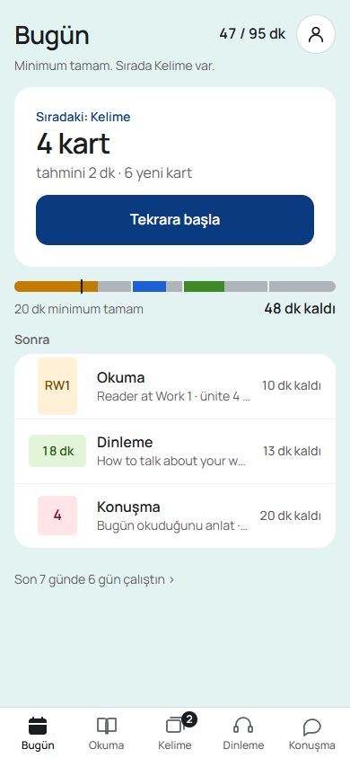
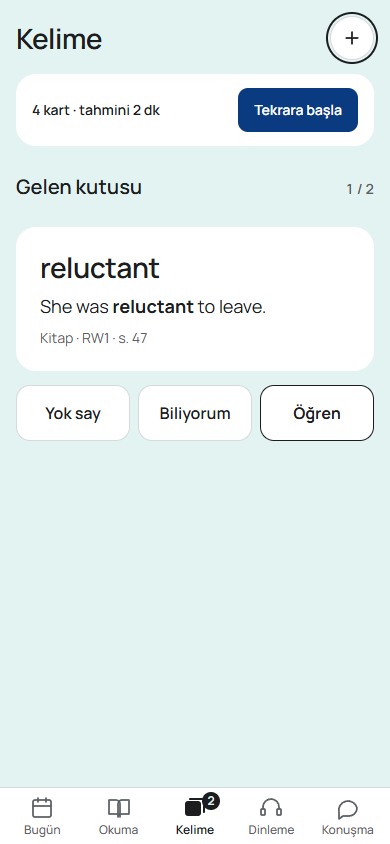
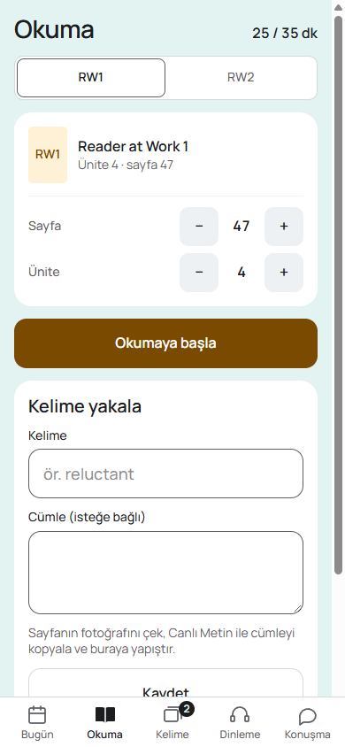
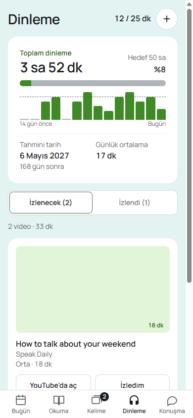
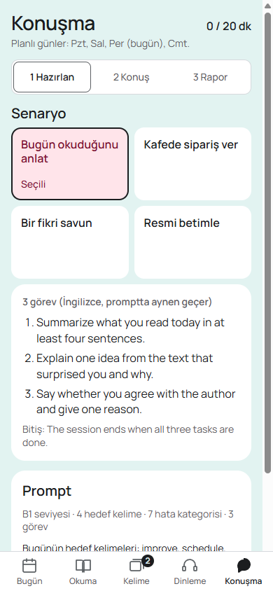
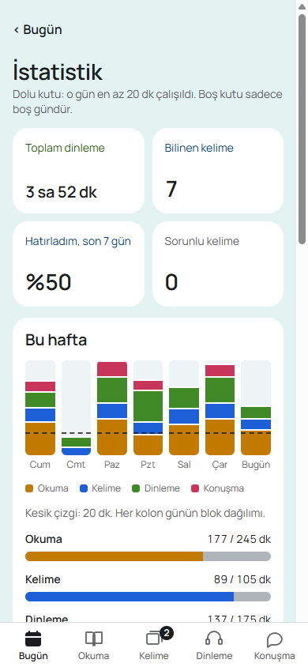

# ENG-LEARN

Kişisel İngilizce öğrenme uygulaması. Telefona kurulabilen bir web uygulaması (PWA) olarak çalışır.
Okuma, kelime, dinleme ve konuşma çalışmalarını tek yerde takip eder.

## Ekran görüntüleri

Görüntüler telefon boyutunda (390 × 844) alındı. İçindeki kelimeler, süreler ve videolar örnek veridir.

  
  
  

  
  
  

## Ekranlar

- **Bugün:** Günün planı, tekrar bekleyen kelimeler ve tahmini süre.
- **Okuma:** Kitaplar ve sayfa ilerlemesi.
- **Kelime:** Aralıklı tekrar (FSRS algoritması) ile kelime kartları.
- **Dinleme:** Dinleme süresi ve hedef takibi.
- **Konuşma:** Konuşma senaryoları ve hata kayıtları.
- **İstatistik:** Çalışma geçmişi ve ilerleme.

## Teknoloji

- Vite, React, TypeScript (strict)
- Tailwind CSS
- IndexedDB (`idb`) ile cihazda çalışan veri katmanı
- Supabase ile giriş ve cihazlar arası eşitleme (Row Level Security açık)
- `ts-fsrs` ile tekrar zamanlaması
- Vitest ile testler, oxlint ile lint

## Belgeler

- `docs/ogren/`: Her aşamada ne yapıldığını anlatan Türkçe öğrenme notları.
- `docs/lisanslar.md`: Kullanılan veri kaynakları ve lisansları.

## Haklar ve lisans

Bu depodaki kod yalnızca incelenmek için herkese açıktır. Açık kaynak lisansı verilmemiştir.
Tüm hakları saklıdır. Kodun izin alınmadan kopyalanması, değiştirilmesi, dağıtılması veya başka bir
projede kullanılması yasaktır.

İstisna: `src/data/seed/ngsl-1.2.json` dosyası bu kuralın dışındadır. Bu dosya New General Service
List (NGSL) 1.2 listesinden türetilmiştir ve kendi lisansıyla dağıtılır:

Kelime listesi: New General Service List (NGSL) 1.2, Browne, C., Culligan, B. ve Phillips, J.,
[CC BY-SA 4.0](https://creativecommons.org/licenses/by-sa/4.0/) lisansı ile.
https://www.newgeneralservicelist.com
Listeden yalnızca sözcükler alınmış ve JSON biçimine çevrilmiştir.
